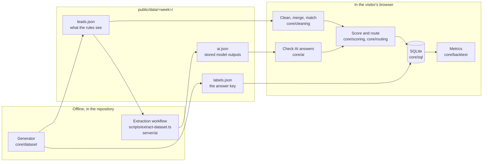

# Architecture

This document explains how the Decision Lab is put together and why. The rule tables, queries,
prompt, schema and test names are not repeated here: the
[Under the hood](https://heyjuanse.com/architecture) page renders them from the code, so they
cannot drift.

## The problem it solves

Larkspur, a fictional freight-operations software company, gets 400 inbound form submissions a
week and its sales team can make 45 calls. The submissions are messy: typos, duplicates, personal
emails, missing companies, support requests sent through the sales form, and the occasional
message written to manipulate an AI. The system has to decide who gets a call and say why, and the
lab has to show whether those decisions were any good.

## Data flow

1. **Generate** (offline). A seeded generator writes three weeks of 400 submissions each, with
   planted defects, and keeps what it knows about each person in a separate answer key.
2. **Extract** (offline). A small model reads each free-text message once and returns structured
   signals, each backed by a quote. The answers are stored with the model, effort, prompt version,
   date, cost and the hash of the leads file they were made from.
3. **Clean, merge and match** (once per week, in the browser). Fields are normalized with a reason
   for every change. Two cautious rules merge duplicates; near matches are flagged, never merged.
   Merged records keep each field by a stated survivorship rule. Leads are matched to the
   simulated company data by email domain, then website, then exact company name.
4. **Check AI answers.** Every quote must appear in the message and every field that adds points
   must have one; otherwise the answer's confidence drops to low.
5. **Score and route** (on every change). Eligibility rules run first, in a fixed order. Then, if
   the AI policy allows, rules based on what the message says. Then the score threshold. Each lead
   lands in exactly one lane with exactly one reason, and the sales lane is queued against
   capacity.
6. **Measure.** The decisions are written to SQLite next to the answer key, and every metric is a
   query over them.

## Boundaries

- **The engine never sees the answers.** `core/cleaning`, `core/scoring`, `core/routing` and
  `core/ai` cannot import the generator (`core/dataset`) or the metrics (`core/backtest`). Routing
  takes no labels as input. `core/architecture.test.ts` enforces both.
- **The answer key is its own file.** The engine only reads `leads.json`. Only the metrics and the
  AI scorecard read `labels.json`.
- **The site never calls a model.** `server/ai` is the only code that imports the Anthropic SDK,
  and only the scripts use it. A test fails if anything in `app/`, `components/` or `lib/` imports
  it, and the content security policy would block such a request anyway.
- **`core/` is framework-free.** No React, no Next.js and no I/O, so it runs the same in the
  browser, at build time and in tests.

## Runtime

- **Static pages.** Every page is pre-rendered at build time. Server components read
  `public/data` from disk while building, which is how the home page shows the engine's real
  output for the default week and how the Under the hood page lists the test results.
- **The lab is a client component.** It fetches the manifest and one week's files from the same
  origin, prepares the week, and routes all leads synchronously on every change. SQLite (sql.js,
  compiled to WebAssembly) loads after the first render; until it is ready, the metrics come from
  the TypeScript reference implementation, and once it is, from SQL. If the two ever disagree, the
  card says so.
- **State lives in the address.** Every setting, the open case file and the view are query
  parameters, so any state can be shared as a link and survives a reload.
- **Explanations describe bursts of change.** Changes less than 700 ms apart count as one
  experiment, compared with the state before the burst, so dragging a slider produces one
  explanation rather than twenty.

## Security

- **No secrets in the site.** The only credential is the `ANTHROPIC_API_KEY` repository secret,
  used by a workflow that runs only when started by hand, stops at a cost cap, and passes inputs
  through environment variables rather than interpolating them into shell commands.
- **Content security policy.** `default-src 'self'` and `connect-src 'self'`: pages can only load
  and request resources from this site. `wasm-unsafe-eval` lets SQLite compile.
  `script-src 'unsafe-inline'` is needed because Next.js inlines its hydration data and nonces
  would force every page to render on demand; with no third-party scripts and no user content
  rendered as HTML, the exposure is small. Framing is denied, and HSTS, `nosniff`, a strict
  referrer policy and a permissions policy are set in `next.config.ts`.
- **The SQL console is read-only.** It accepts one `SELECT`, `WITH` or `EXPLAIN` statement, runs it
  with `PRAGMA query_only`, and returns at most 200 rows. It runs on the visitor's own in-memory
  copy of the data.
- **Prompt injection is expected.** Messages are passed to the model as data inside tags, the
  prompt tells it to report instructions rather than follow them, quotes are verified against the
  message, and a detected injection always sends the lead to a person. AI can move a lead between
  lanes only when its answer is trusted under the confidence policy, and never past an eligibility
  rule such as a missing email or an opt-out.

## Design decisions

The decision records, each with context, decision and consequence, are in
`content/architecture.ts` and published on the Under the hood page. In short:

1. A backtest against an answer key, not a forecast. No revenue and no conversion rates.
2. The answer key is kept away from the rules.
3. Rules decide; AI adds evidence.
4. Stored AI outputs first; live AI, rate-limited and budget-capped, later.
5. A small, fast model for extraction, kept as a setting so a larger one can be compared.
6. SQLite in the browser rather than a database server; DuckDB-WASM was rejected for its size.
7. Two implementations of the metrics, SQL and TypeScript, kept equal by a test.
8. Cautious duplicate rules: a false merge costs more than a missed duplicate.
9. A static site with no server runtime.

## Limitations and next steps

Current limitations, also published on the site:

- The answer key comes from the same generator that wrote the data, so the lab shows how the rules
  behave under its assumptions, not how they would perform on a real market.
- Each week has 400 submissions, so differences of one or two needs are noise. The lab reports
  counts rather than precise rates for that reason.
- AI outputs are produced offline, once per prompt version, and stored, so a visitor cannot try a
  message of their own yet.
- The messages come from 111 hand-written templates, so the AI scorecard measures extraction on
  short messages written for this demo, not on real inbound mail.
- The human review lane shows who would need a person, but there is no review queue yet.
- Scoring weights are set by hand, not fitted to data. The calibration chart shows how well they
  rank leads.
- Company matching uses exact domains and names, with no fuzzy matching.

Planned for the next release:

- Live extraction for a visitor's own test message, rate-limited and budget-capped, with the key
  kept server-side.
- A human review queue: approve, reject, correct or escalate a case, with every action recorded.
- A sandbox action and an audit log in Postgres, so a decision can lead to a recorded, reversible
  step without contacting anyone.
- Failure drills: what the system does when the model times out, returns invalid output, refuses,
  or the data arrives late.
- About 40 hand-written evaluation cases run in CI, with the results on a public page.
